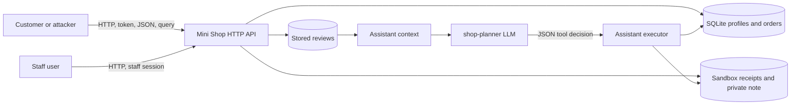

# Mini Shop Threat Model

## System

## Assets

- Customer profiles, addresses, orders, and receipts
- Staff-only profile export and private operational data
- Session tokens and login credentials
- Reviews and assistant prompts
- Database integrity, catalog prices, and sandbox files

## Trust Boundaries

- The client is untrusted even after login; IDs, paths, prices, role headers, and assistant decisions are attacker-controlled.
- HTTP input crosses into SQL, HTML, filesystem, and JSON processing.
- Review text crosses into the assistant context and may contain prompt-injection instructions.
- An LLM decision crosses into a privileged server-side executor and must be authorized again.
- The sandbox provides physical containment, but not per-user authorization.

## Threats and Controls

| Threat | Impact | Control |
|---|---|---|
| SQL injection in IDs and searches | Data disclosure or modification | Parameterized SQL and input validation |
| Customer accesses another customer | Personal-data disclosure | Session-derived ownership checks |
| Forged `X-Role` header | Staff privilege escalation | Server-side role from authenticated session |
| Client-controlled order price | Financial tampering | Always use catalog price |
| Receipt path manipulation | Cross-account or private-file disclosure | Derive account path and allow only own receipt |
| Stored HTML/script in reviews | Browser code execution | HTML escaping |
| Forced assistant tool decision | Data disclosure or file deletion | Authenticate and authorize every tool; disable deletion |
| Prompt injection in review content | Unsafe model proposal | Treat context as untrusted and enforce executor authorization |
| Public debug logs | Token and request disclosure | Staff-only access and token redaction |
| Internal exception disclosure | Implementation and data leakage | Generic client-facing errors |

## Residual Risk

The exercise uses static educational credentials and in-memory sessions. A production service would additionally need secure password storage, token expiry and revocation, CSRF protection where applicable, rate limiting, audit logging, and a hardened deployment configuration.
